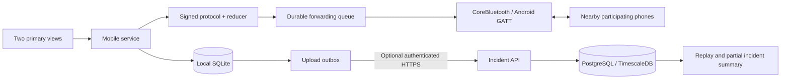

# Beacon architecture

## Local operation

SecureStore holds a self-generated Ed25519 identity. SQLite commits messages, derived request state, observations, and upload work atomically. An SOS returns after local persistence; discovery and forwarding occur independently. A restart restores the same identity, request state, pending forwarding, and cloud outbox. Optional location is bounded and never prevents request creation.

Native code scans, advertises, connects, fragments, and reassembles real GATT traffic. Shared TypeScript verifies canonical signatures, authenticates origin IDs, bounds message and peer work, suppresses duplicates, enforces expiry/hop budgets, and requests missing messages. A successful native send proves only transport acceptance. The application protocol supplies separately signed receipt, seen, offer, acceptance, and assignment-receipt messages.

Participants and relays can read community request contents. Self-generated signatures prove possession of a device key, not a person's identity, qualification, or trustworthiness. There is no claim of end-to-end encryption or guaranteed delivery. The protocol provides at-least-once transport with deduplicated application effects.

## Status and assistance

The requester sees local persistence, forwarding, recipient receipt, and volunteer confirmation as separate facts. A volunteer offers assistance; only the requester accepts. The helper's signed receipt of that assignment is the evidence for “Volunteer confirmed.” Last confirmed state persists across disconnects. Cancellation/completion are requester revisions with retained tombstones; disconnected phones may temporarily hold older state.

## Offline maps

The app bundles a small UW campus GeoJSON extract with all rendering resources inline. It has no network tile/font/sprite dependency. Outside the supported rectangle, the app presents coordinates and descriptions explicitly. Optional provider regions use MapLibre's offline pack manager; provider licensing and actual resource completeness must be verified before distribution.

## Optional cloud

Local operation does not require a server or account. When configured, a scoped token uploads persisted observations in bounded batches. Only durable server acknowledgments remove outbox work. The API validates signed envelopes, membership, and event shapes; inserts are idempotent across event IDs and per-device sequences. Replay is paginated and summaries remain explicitly incomplete because disconnected phones may not have uploaded.

Cloud replay never changes the on-device delivery or assistance state. Cross-device timestamps are not used as round-trip measurements. The mobile summary derives request-to-receipt intervals only from observations made by the same requester phone.

## Deliberate limits

Foreground operation is the dependable design target. iOS background discovery, suspended applications, force quits, OS power management, radio contention, and sparse participants can prevent delivery. See [PROTOCOL.md](PROTOCOL.md), [NATIVE_TRANSPORT.md](NATIVE_TRANSPORT.md), and [SECURITY_REVIEW.md](SECURITY_REVIEW.md) for concrete bounds and limitations. Hardware acceptance and release evidence are recorded separately from implementation claims.
