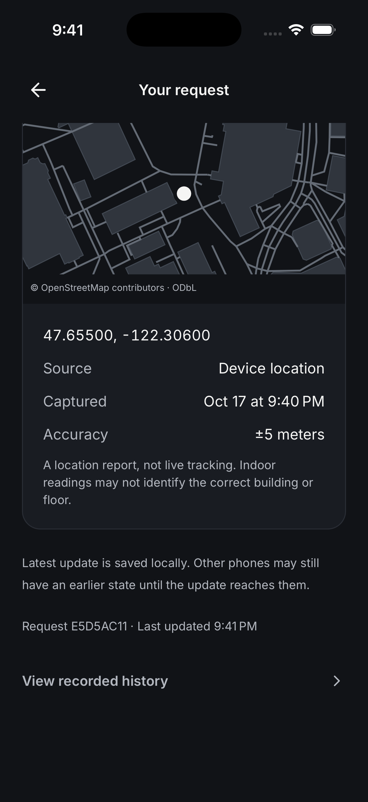
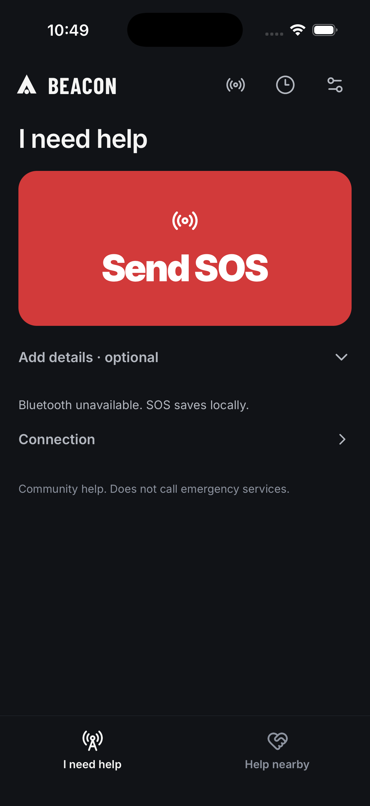
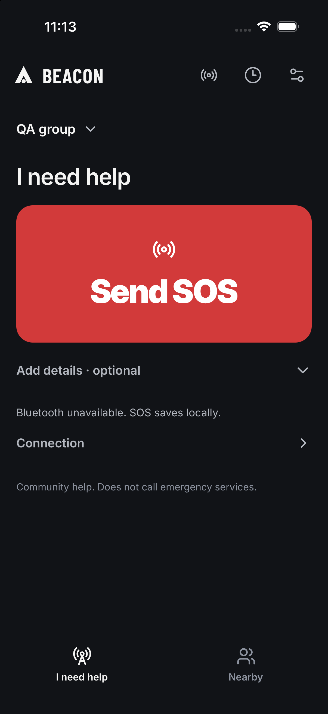

# Simulator UI validation

## Simpler Home and direct actions — October 18, approximately 05:46–05:49

Current production JavaScript/assets were exported into the existing compatible iPhone 17 Pro / iOS 26.0.1 simulator app, ad-hoc signed, installed, and launched. Native transport was unchanged. A separate full Release build for physical iPhones and strict signature verification passed.

- Home has one warm SOS hero, centered audience selection, collapsed optional details, one connection row, and distinct People / Map shortcuts. All main controls fit at the simulator's existing text size.
- Home → Map selected Map in one tap and displayed bundled UW streets/buildings plus the actual simulated You position. Sharing stayed off. Home → People and Inbox → Find people selected People even after Map had been selected previously.
- Entered `SIMULATOR QA - no emergency` in the optional note through native accessibility. One tap saved the local SOS and opened details, which showed **Waiting for a connection**, **Saved on this phone**, and a dated **Not live** location. No recipient or volunteer was fabricated.
- Cancel request retained its confirmation. Confirming reached **Canceled**, explaining that propagation was pending. Home again displayed Send SOS; no active QA request remained.
- Full workspace checks: 181 passed, one database-dependent skip, zero failures; TypeScript and ESLint passed. After final alignment/copy changes, all 21 focused Help/request, inbox and Nearby tests passed. These include exact-offer acceptance guards, discovery/resume actions, audience filtering and direct view navigation.
- Both physical phones remained unavailable in devicectl and offline in xctrace despite the user's connection report. This version is built but **not installed** on either phone. Earlier installation evidence belongs to the previous version.

Native captures: [Home](screenshots/simple-layout/home.png), [Map](screenshots/simple-layout/nearby-map.png), [Messages](screenshots/simple-layout/messages.png), [Request](screenshots/simple-layout/request.png). Build fingerprint and checks: [simple-layout.json](evidence/simple-layout.json). This pass does not establish physical BLE/audio, saved-area downloads, or new full accessibility acceptance.

## Reference-inspired interface — October 18, approximately 03:57–04:02

Current production JavaScript and assets were exported into the existing compatible iPhone 17 Pro / iOS 26.0.1 simulator binary, ad-hoc signed, installed and launched. Device Hub provided native accessibility control. This UI pass did not change native transport code.

- Inspected the circular SOS, restrained charcoal palette, Help/Nearby navigation, empty inbox, profile settings, and audience sheet. Selecting the existing QA group updated the audience; Public Nearby was restored. No request, peer, or conversation was fabricated or sent in this pass.
- Nearby Map rendered the bundled UW streets/buildings and current simulated You position. Location sharing remained off. Visual inspection exposed an overly tall map, so the final layout moves the sharing switch above a shorter viewport. Map options, Locate and OSM attribution now fit the default phone viewport. Historical coverage and position age remain below the map.
- Profile Edit revealed the optional name form; changing its draft enabled Save. Cancel discarded the edit. Location & map opened Nearby with Map selected. Messages opened the real empty inbox.
- Home rendered correctly at standard size and, after a fresh launch, at XXXL text size. Changing Dynamic Type while the app was already running temporarily clipped labels until restart; this remains a known limitation. The simulator was restored to its original large text setting and left on Help. Keyboard entry, populated chats and full screen-reader order were not validated in this pass.
- The workspace suite passed 172 tests, with one database-dependent skip and no failures. TypeScript and ESLint passed. Focused Help and Nearby checks passed after the final copy and map sizing changes.
- A separate fully signed Release device build passed signature verification. Both physical-phone installations succeeded. Per-phone launch results and the exact embedded bundle fingerprint are in [reference-design.json](evidence/reference-design.json). Installation or simulator rendering does not establish real BLE, audio, or saved-area download acceptance.

Final native captures: [Help](screenshots/reference-design/home.png), [Map](screenshots/reference-design/nearby-map.png), [Messages](screenshots/reference-design/messages.png), [Profile](screenshots/reference-design/profile.png), [Audience](screenshots/reference-design/audience.png), and [XXXL Home after fresh launch](screenshots/reference-design/home-large-text.png).

Observed through native CUA against the existing **iPhone 17 Pro / iOS 26.0 Simulator**, October 17, 2026, approximately 21:40–21:42 America/Los_Angeles. This was the rebuilt Release app after the fractional location timestamp correction. No production source was changed during this smoke test.

## Confirmed from the running app

- Home showed exactly the two primary tabs, a single red Send SOS action, collapsed optional details, a dated location report, and an honest Bluetooth-unavailable message.
- One tap on **Send SOS**, with optional fields untouched, created synthetic local request **E5D5AC11** at 21:40 and opened its details. The previous timestamp-validation error did not recur.
- Details displayed **Waiting for a connection**, **Saved on this phone**, and explicitly pending connection, recipient receipt, and human response. It showed zero offers and did not claim delivery.
- The actual native map viewport rendered the bundled UW building polygons and roads with a white reported-location marker. OpenStreetMap/ODbL attribution was visible. The explicitly simulated report was **47.65500, -122.30600**, accuracy **±5 meters**, captured October 17 at 21:40.
- **Cancel request** displayed a confirmation explaining delayed propagation. Confirming produced **Canceled** and the explicit statement that the cancellation was saved locally and waiting to travel.
- **View recorded history** showed exactly two local events, **SOS saved** and **Request canceled**, two pending uploads, and **Never synced**. No incident was connected and no cloud sync was enabled or performed.
- Advancing incident replay selected **SOS saved**, **1 of 2**, and a single red selected event marker.
- Back navigation returned through the canceled request to home; home again offered **Send SOS** rather than presenting the canceled request as active.

The map screenshot was saved using Simulator’s **Save Screen** toolbar action and copied without modification from its native Desktop destination:

## Boundaries

This verifies the local simulator UI and the displayed map viewport. It does **not** verify Bluetooth transfer, real recipient receipts, offers/assignment exchange, physical-device location, airplane-mode cold-start mapping, cloud ingestion, restart persistence, or a ten-run reliability result. The simulator explicitly reports Bluetooth unavailable. This smoke used one synthetic request and canceled it afterward. No physical iPhone or Xcode UI was controlled in this pass.

Wheel/drag attempts did not move the simulator viewport through CUA, while accessibility-targeted actions successfully brought their controls into view. Map rendering was visually observed after cancellation shortened the request page. This is a tool-interaction observation, not evidence of a touch-scrolling defect in the app.

## Minimal interface pass — October 17, approximately 22:47–22:50

Removed slogans and promotional paragraphs from the app. Home prioritizes one Send SOS control; optional category, note, place and phone-location report are collapsed. Connection, history and settings use accessible header buttons. Nearby requests use compact cards. Request delivery status appears before offers and completion controls; offer/accept controls precede the map. Advanced map, cloud and local-data settings are collapsed, with Save settings fixed outside the scroll area.

Validation used the existing native Simulator binary with a freshly exported production Hermes JavaScript bundle and assets, then an ad-hoc signature and reinstall. Native code was unchanged. This was not a full native rebuild under the newly installed Xcode.

- Expanded and collapsed optional SOS fields through native accessibility controls.
- Created one synthetic local SOS with one tap, with details left blank.
- Observed Waiting for a connection and Saved on this phone; no delivery was claimed.
- Observed the bundled UW map and timestamped location marked Not live.
- Completion retained a confirmation. Confirming returned home to Send SOS after relaunch.
- Verified primary tab navigation and the empty nearby-request state.
- Verified collapsed settings and expanded offline map controls; Save settings stayed available.
- Workspace TypeScript and ESLint passed. Existing suite: 53 passed, 0 failed, 1 database-dependent skip.

The Simulator has no BLE transport. This pass does not establish real phone receipt/offer/acceptance or delivery reliability. The connected new iPhone requires its own signed build and installation.

## Nearby and groups — October 17, approximately 23:08–23:15

Xcode 27.1 exposes simulator UI through Device Hub. This pass used the existing native iOS Simulator app with the newly exported production Hermes bundle, signed and installed locally. It is separate from the full signed physical-device build.

- Created a local `QA group` through the actual group form; selected scope appeared on Home and Nearby.
- Sent one synthetic group SOS with optional details untouched. It showed Waiting for a connection and Saved on this phone, with no location or delivery invented.
- Canceled that synthetic request through its confirmation. The closed state explained that other phones could still have an older state.
- Relaunched the app and verified selected-group restoration, Send SOS, and removal of the unrelated slow-location error banner.
- Inspected Nearby, the group selector, and the chat layout. A single explicitly labeled `QA contact (test)` was inserted into the simulator database solely to inspect navigation to an empty conversation; this was not Bluetooth discovery. The empty Send control was disabled. The fixture contact was removed afterward.
- Device Hub automation could fill the single-line group name through accessibility, but did not enter text into the multiline composer. Manual text entry/send is therefore not claimed by this UI pass. Actual service tests separately verify message persistence and authenticated delivery acknowledgment using synthetic links.

This simulator has no Bluetooth transport. New physical nearby-message/group delivery still requires two updated phones. The screenshot shows the simulator's actual Home and its honest Bluetooth-unavailable state.

## Simplification and keyboard pass — October 18, 00:24–00:27

Observed through Device Hub on iPhone 17 Pro / iOS 26.0.1 Simulator. A freshly exported production iOS JavaScript bundle and assets were installed into a copy of the existing simulator native app (`tmp/simplified-ui/Beacon.app`), ad-hoc signed, then launched. This is current UI evidence, not native-call evidence.

- Home has one Settings header button, a group selector, immediate Send SOS, collapsed optional details, and an honest Bluetooth-unavailable message. No additional SOS was sent in this pass.
- Nearby displays one empty state without empty request cards or invented people.
- Groups displays scope selection and Join/Create actions. Opening Join reveals its fields; the submit button stays disabled for empty required fields. Cancel returns to the compact group screen. The existing local QA group was not modified.
- Settings exposes name, sharing, History, and Connection status; permission, map, cloud, and advanced controls start collapsed. No Save button appears before an edit.
- Found and fixed Save changes being covered by the iOS software keyboard. A `KeyboardAvoidingView` now keeps it visibly above the keyboard. Re-exported and reinstalled, then verified the corrected layout with a temporary name draft. Restored the original draft without saving it, returned to Home, and left no new request or changed profile.
- Settings ESLint and mobile TypeScript checks passed after the correction. Default simulator text size was visually checked; this was not a large Dynamic Type or VoiceOver session.

Screenshots were captured through Device Hub's Screenshot button and copied unchanged from its Desktop output:

| Screen | Evidence |
| --- | --- |
| Home | [home.png](screenshots/simplified/home.png) |
| Nearby | [nearby.png](screenshots/simplified/nearby.png) |
| Groups | [groups.png](screenshots/simplified/groups.png) |
| Settings | [settings.png](screenshots/simplified/settings.png) |
| Corrected keyboard layout | [settings-keyboard.png](screenshots/simplified/settings-keyboard.png) |

No peers, receipts, or call states were injected. No cloud sync or physical-phone interaction occurred. Bluetooth calls are unsupported in this old simulator native build; this pass establishes neither audio transport nor physical-device delivery.

## Removal pass — October 18, approximately 00:33

The user requested actual removal of excess controls after the preceding collapsed-settings approach. Settings now contains only the profile name, Nearby sharing toggle, and Phone permissions action. Cloud configuration, custom map download controls, diagnostics, history links, and connection-status links are removed from the visible app flow. Their underlying routes/storage/transport remain intact and unlinked; they are not presented as retained user-facing features.

Request details retain receipt-versus-volunteer-confirmation distinctions, offer/accept/close actions, and the reported-location map. Request IDs, history links, manual Mark as seen, and seen counts were removed. Opening another participant's active request now triggers an idempotent acknowledgment in the background, guarded by request ID; this last effect passed TypeScript and lint but was added after the simulator bundle used for the following Home/Settings screenshots.

Fresh current visual code was exported into the same old simulator native app. Actual Home and the three-control Settings screen rendered without clipping. Editing a temporary name showed Save name above the software keyboard; the draft was restored without saving, and the app was left on Home. No SOS, peer, or call was generated. Native-call verification is outside this simulator pass.

- [Current Home](screenshots/simplified/home-core.png)
- [Current Settings](screenshots/simplified/settings-core.png)
- [Current Settings with keyboard](screenshots/simplified/settings-core-keyboard.png)

All changed UI files passed scoped ESLint; mobile TypeScript passed after the automatic acknowledgment addition. No production source edits followed this freeze.

## Nearby map and invite flow — October 18, approximately 00:54–00:55

Current production JavaScript and assets were exported into `tmp/simplified-ui/Beacon.app`, ad-hoc signed, installed, and launched on the existing iPhone 17 Pro / iOS 26.0.1 Simulator. This uses the older compatible simulator native binary; physical-device builds and Bluetooth testing are separate.

- Nearby rendered the actual OpenFreeMap Positron map with readable UW campus street/place labels. No person pins were present. The map accurately said “No shared positions yet” and “Online map · area overview.” The native attribution control was visible; opening its contents was not verified.
- Share my location was visibly off, with “With everyone nearby” identifying its audience. It was not enabled during this pass.
- The existing simulator reported Bluetooth unavailable and disabled Find people. No discovery, Bluetooth call, position receipt, or selected-person Message action is claimed by this visual pass.
- Tapping the group chip opened Groups. Join showed only the invite-code field, with its empty submit disabled. Cancel and Back returned to Nearby. No group, profile, or scope was changed; the visible QA group predates this pass.
- Native map-drag automation returned a no-windows-available error despite subsequent accessibility reads working. Map panning and recenter behavior were therefore not verified. No fake contacts, positions, receipts, or requests were inserted.
- Scoped ESLint and mobile TypeScript passed. Freshness filtering uses the protocol's 120-second lifetime and five-second future-clock tolerance; age labels clamp negative age to zero. Active help requests remain above the map in the UI structure, but none were active for these screenshots.

The public online style was checked against [OpenFreeMap's official quick start](https://openfreemap.org/quick_start/) and fetched successfully before use. The component retains the bundled UW fallback; this pass observed the online path, not a forced network-failure transition.

Screenshots were saved with Device Hub's native Screenshot control, copied unchanged from Desktop, and visually inspected:

- [Nearby map, sharing off](screenshots/simplified/nearby-map.png)
- [Invite-only join form](screenshots/simplified/group-invite-only.png)

No production UI source changed after the final Positron style selection. The app was left on Nearby with sharing off.

## Offline-first maps — October 18, approximately 01:02–01:05

Nearby now defaults to a valid saved local map, otherwise the bundled UW geometry, independently of internet availability. Online map viewing is an explicit action. Save my area uses the service's bounded area-download operation; cancellation is available while saving. Both map components retain the bundled fallback, readable light geometry, and honest coverage labels. RequestMap retains the reported-position pin outside street coverage.

Actual-app observation used the existing simulator native binary with a fresh production JavaScript export. On the first Nearby visit, the bundled map displayed buildings, paths, parks, and the fountain without selecting View online. The caption read “UW campus · offline map · area overview.” Sharing remained off; no peer pins were fabricated. The map's real TypeScript initializer was extracted with the TypeScript AST and evaluated with the shipped GeoJSON. Official `@maplibre/maplibre-gl-style-spec` 26.4.4 validation returned no errors. All 2,764 features passed geometry/layer compatibility checks. The style contains no network source URLs, glyphs, sprites, imports, or symbol layers. Host Wi-Fi was not disabled; this establishes rendering of a fully self-contained style, not a network-isolation test.

For outside-coverage verification, simulator Custom Coordinates was temporarily set to 47.67, -122.32. Beacon still reported location unavailable. A clearly labeled synthetic local request contained only its QA place description (the existing service intentionally uses a manual description instead of GPS when Place is supplied, so this request itself did not establish GPS failure); it was canceled and the Canceled state was observed. The original 47.655, -122.306 simulator coordinates were restored.

Two temporary renderer harnesses then exercised the actual RequestMap component, with “SIMULATOR UI TEST FIXTURE” prominently displayed:

- An explicitly synthetic outside-campus position rendered its pin on the otherwise empty map, with “OUTSIDE UW CAMPUS · REPORTED POSITION” and OSM attribution. No application request, contact, or receipt fixture was inserted.
- The protocol owner's exact generated local style (`/tmp/beacon-saved-geometry-renderer-fixture.json`) was written to a simulator cache file and passed through `MapState.styleUrl`. It was generated by the actual `createOfflineAreaStyle` helper from real bundled UW coordinates converted into the provider input format. Native MapLibre displayed its streets/buildings, fixture pin, and attribution control. This verifies local-file rendering, not a live provider download or the full Save my area lifecycle.

The genuine Beacon app was reinstalled and observed on Home with Send SOS; no active synthetic request remained. Temporary harness source/data was moved outside the mobile project into ignored `tmp/offline-renderer`. No physical-phone interaction, BLE delivery, audio, or live location-sharing claim follows from this pass.

Evidence captured using Device Hub's native Screenshot control:

- [Actual Nearby bundled map](screenshots/simplified/nearby-bundled-offline.png)
- [Outside-coverage renderer fixture](screenshots/simplified/request-outside-coverage-fixture.png)
- [Saved local-geometry renderer fixture](screenshots/simplified/saved-geometry-fixture.png)

Scoped UI lint and mobile TypeScript passed after the final saved-map preservation and non-destructive cancellation integration. The final UI accepts an explicit `savedAvailable` marker for a previously validated map during a replacement download, and remounts a saved style when its `updatedAt` changes so overwriting the same local filename refreshes the geometry. These final lifecycle predicates were added after the screenshots; they do not change the layouts shown above.

## Actual local GPS and save attempt — October 18, approximately 01:15–01:32

The genuine app was tested with current production JavaScript on the existing compatible iPhone 17 Pro simulator binary. No request/contact fixtures or saved geometry files were inserted. Simulator Custom Coordinates was explicitly reapplied as 47.655, -122.306 before the final instrumented attempt.

- Entering Nearby with its existing granted location permission refreshed the local fix and displayed the actual simulated “You” pin, initially “0s ago · ±5 m,” on the bundled UW buildings and paths. Sharing stayed off. The explicit locate control refreshed the age from 27 seconds to one second without enabling sharing.
- The compact map, location switch above it, OSM attribution, and truthful “No one connected yet” state rendered. This simulator reports Bluetooth unavailable; connected-peer pins and radio delivery are not established by this pass.
- The final single instrumented Save my area attempt displayed Cancel save while pending, then returned after roughly 40 seconds with: “Could not reach the map provider. Try again while online. Attempts 1: HTTP 500; 2: network AbortError.” The first attempt used Private.coffee GET; the fallback used overpass-api.de POST and hit its bounded timeout. Earlier native attempts returned HTTP 500 or a final HTTP 502. A successful host GET reported separately by the protocol owner means a general provider outage is not established.
- Read-only inspection immediately afterward found zero `beacon-area-*.json` files. SQLite `offlineMap` still identified the bundled UW geometry, with the exact attempt error above. The bundled map remained visible; no save success or downloaded-map restart is claimed. Host networking was left unchanged.

[Native attempt-chain screenshot](screenshots/simplified/native-save-attempt-chain.png) was saved through Device Hub’s Screenshot control, copied unchanged, and visually inspected. The failed attempt was reported immediately to the service owner and root for diagnosis; no further native save was started. UI sources remained frozen.

At approximately 01:33, one additional native Save tested the service owner's narrow `Accept-Encoding: identity` change after a host compression probe reproduced HTTP 500. A fresh export was installed and Nearby obtained a new local fix. The actual app again returned “Attempts 1: HTTP 500; 2: network AbortError” after about 34 seconds. The encoding hypothesis did not resolve the native flow. [Identity-header attempt](screenshots/simplified/native-save-identity-attempt.png) captures the result; no further save was started and no downloaded-map reopen is claimed.

## Expanded bundled area and focus-camera correction — October 18, approximately 01:35–01:42

An actual Nearby screen test at simulated 47.67, -122.32 confirmed that explicit Locate renders a centered You pin even outside offline street coverage. A separate real bug was reproduced: leaving Nearby, changing the simulated position, and returning refreshed the location age but left the camera at the previous area, so the pin was offscreen. The fix fits the map once after a successful focused GPS refresh, guarded against completion after blur; ordinary clock/location updates do not continuously reset gestures. Both map components now import the asset owner's shared coverage bounds. Mobile TypeScript and scoped ESLint passed.

After exporting the production UI and expanded real OSM asset, the regression was rerun without fixtures: Nearby at 47.67, -122.32 → Home → Simulator coordinates 47.663, -122.306 → Nearby. Without tapping Locate, the camera moved to the fresh centered You pin and displayed bundled streets/buildings at this point outside the old coverage. The caption read “UW campus · offline map”; the out-of-coverage badge disappeared. Sharing remained off. [Focus regression passing](screenshots/simplified/nearby-expanded-focus.png).

The genuine app process was then terminated and relaunched (no reinstall or map-file injection). Reopening Nearby displayed the same expanded streets and an initial fresh local pin. After the two-minute location lifetime elapsed during observation, the stale pin disappeared as designed; tapping Locate restored a fresh centered pin without enabling sharing. [Restart and refreshed pin](screenshots/simplified/nearby-expanded-restart.png). Read-only SQLite inspection after restart confirmed offlineMap ready, bundled true, expanded coverage bounds, 1,700,884 bytes, and no error. No Save area or View online was invoked in this pass. The bundled style is self-contained; host networking was not disabled, so this is not a network-isolation test. No real-peer/Bluetooth proof is implied.

UI sources remained frozen after the tested camera change. The simulator was left at public test coordinates 47.663, -122.306 with sharing off.

## Layout redesign — October 18, approximately 02:31–02:35

Current production JavaScript/assets were exported into the existing compatible simulator app, ad-hoc signed, installed, and launched. The export includes the keyed Help audience-draft reset. It precedes only the later removal of the redundant setup footer link; the already-configured simulator did not revisit setup. No source changes followed this walkthrough.

- Help rendered one title, audience selection, SOS action, optional details, and incoming-request section. A single request labeled “SIMULATOR QA - no emergency” in its Place field was sent through the actual UI. Request details showed “Waiting for a connection” and “Saved on this phone.” Request options → Cancel request → confirmation reached “Canceled,” with pending propagation stated honestly. No active synthetic request remained.
- Nearby opened in People mode. The compatible simulator native build reports Bluetooth unavailable, so Find was disabled and the empty state explained the limitation. Map selection rendered the real expanded UW geometry and a fresh simulated You pin. Explicit Locate refreshed the fix; the sole sharing switch stayed off. No online-map view, map download, fabricated contacts, radio receipt, or call was used.
- Groups showed its choices first. Join and Create each revealed only their respective form, with empty submit disabled; Cancel returned to choices. No group was created and no invite was shared. An unsent Help Place draft was entered, the existing QA group selected, and Add details reopened: the Place field was empty. Everyone nearby was then restored and details were collapsed.
- Settings rendered its name field, Nearby sharing, Phone permissions, and collapsed Advanced disclosure. Editing the name through the accessible field revealed Save name. Restoring the original text removed it; no profile change was saved.
- No blocking layout issue was observed at the simulator’s current text size. Larger Dynamic Type and software-keyboard overlap were not tested in this pass. Multiline note typing through CUA did not enter text, and a coordinate-based attempt returned `noWindowsAvailable`; the accessible Place field worked and was used to label the synthetic request. This is an automation limitation, not evidence that app typing is broken. The simulator keyboard-capture preference was restored to off.

Native Screenshot captures: [Help](screenshots/redesign/help.png), [People](screenshots/redesign/nearby-people.png), [Map](screenshots/redesign/nearby-map.png). The first Map capture was incorrectly copied from the prior People image; it was replaced using a fresh native screenshot-control index, and the final saved Map PNG was opened and visually confirmed to show Map selected, sharing off, real streets, and the You pin. Root separately inspected Help and People. Map is scrollable; lower map actions extend below the initial viewport.

This verifies the actual app’s local UI flows on the compatible simulator build. It does not establish BLE discovery, peer chat/call delivery, or keyboard behavior on a physical phone. The app was left on Help, public audience selected, with no active QA request or unsent draft.

## Light reference redesign and emergency-flow fixes — October 18, approximately 06:50–07:20

The supplied white/deep-green reference was implemented across Home, request details, Nearby, inbox, chat and shared controls. Screens use 24-point margins (20 on narrow layouts), two bottom tabs, visible Messages/Profile labels, a wide one-tap SOS, optional collapsed details, flat participant/request rows and outlined secondary actions. Accepted helpers/requesters now have direct chat when a valid current-audience contact exists; service guards preserve the accepted assignment across repeated/competing actions and restart.

The actual iPhone 17 Pro simulator rendered Home, Nearby People and Map. A real local request labeled **SIMULATOR QA - no emergency** was saved, inspected and canceled through the confirmation dialog; Canceled with pending propagation was observed. There are no active synthetic requests. Home was also observed at extra-extra-extra-large Dynamic Type without clipping its key actions, then restored to large. The final compact map viewport fits its legend, offline coverage and position age above the tab bar at default text size. Opening map options hides the recenter control so touch targets no longer overlap.

Map reliability changes keep foreground local GPS fresh every 30 seconds while Map is focused, without enabling sharing or moving the camera after its initial fit. Blur/background guards and recovery from failed or pending fixes are tested. Provider attempts now have a promise deadline covering both headers and body, and cancellation settles even if native fetch ignores abort. A real native save attempt returned HTTP 500 followed by HTTP 502; bundled geometry remained available. No successful new-area download is claimed.

Final integrated validation: **191 passing tests, zero failures, one database integration skip; TypeScript and ESLint pass**. Additional native audio/codec/crypto checks passed. The user reported calling works; available physical logs show older capture/transmit/receive/playback activity but no newly captured post-install call, so audible speech is user-confirmed rather than independently observed.

Current production JavaScript/assets were exported into compatible existing simulator/device binaries and signatures verified. Both physical iPhone installations and launches succeeded. A full native rebuild and extra small-phone simulator install were blocked by local disk capacity; no native source changed here. This does not establish a new paired physical SOS/chat/location acceptance test or worldwide offline street coverage.

Screenshots: [Home](screenshots/light-layout/home.png), [large-text Home](screenshots/light-layout/home-large-text.png), [request](screenshots/light-layout/request.png), [Nearby](screenshots/light-layout/nearby.png), [Map](screenshots/light-layout/map.png). Machine-readable results: [light-layout.json](evidence/light-layout.json).

At 07:16:30–07:18:31 the final map stayed open with sharing off for over 120 seconds; its You pin remained visible with a fresh 10-second age. Save my area → Cancel save returned to the idle save action with bundled geometry retained. Explicit View online rendered street/building geometry and labels. These are simulator observations; no peer locations were injected.

## Inline SOS workflow and performance — October 18, approximately 08:30–08:45

Unchanged background request refreshes retain their existing store snapshot; verified envelope content and derived request states reuse bounded cached work. In a real BeaconService/SQLite host workload of 40 signed synthetic SOS envelopes and ten unchanged refreshes, repeated signature checks dropped from 800 to zero and subscriber notifications from ten to zero; elapsed time dropped from 810.2 ms to 13.9 ms (18.8 ms under concurrent test load). This is host workload evidence, not physical-device frame-rate evidence. Map age ticks no longer rebuild the native map subtree, with exact position-expiry boundaries and stable request camera inputs retained. Validation: [performance evidence](evidence/performance.json).

The separate SOS details interface was removed at the user's request. Actual simulator interaction saved a request labeled **SIMULATOR QA - no emergency** and remained on Help with its header, tabs, status, optional reported location and End SOS action. End SOS → I no longer need help completed the request and returned to the send controls, keeping pending propagation visible. The final compact pending-update caption was observed after repackaging; no active synthetic request remains. The map rendered bundled UW geometry and a fresh simulated location with sharing off. No contacts or radio receipts were fabricated.

Final automated results: **206 passing tests, zero failures, one database integration skip**; TypeScript and ESLint passed. Sixteen Help action tests were rerun successfully after shortening the completion notice. Tests cover direct offers, named acceptance, completion/cancellation choices, scoped messaging, truthful receipt/confirmation states, legacy redirects, map-action eligibility and duplicate presses.

Production JavaScript/assets were packaged into existing compatible native binaries; device/simulator signatures verified. The final app installed on Vaibhav's iPhone. A fresh launch initially returned an iOS developer-verification error; the local profile was valid, included the phone and matched the app. The user subsequently confirmed **Beacon opens**. No fresh paired physical radio/audio test or device FPS measurement is claimed. New-area map provider errors remain unresolved.

Screenshots: [active SOS on Home](screenshots/inline-sos/active.png), [Home after completion](screenshots/inline-sos/home.png). Machine-readable record: [inline-sos.json](evidence/inline-sos.json).
